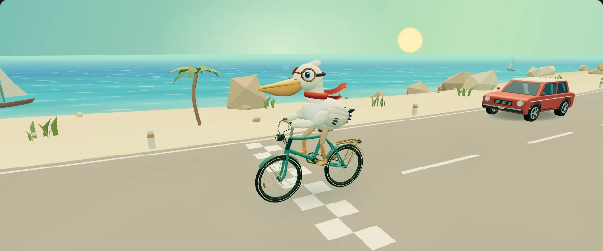

# 鹈鹕骑行 · 海风环线

[在线试玩](https://yricotf.github.io/pelican-velo/)

操控戴护目镜的鹈鹕骑上复古单车，沿海岛公路绕一圈。路线全长约 246 米，经过海崖灯塔和海边小屋。右上角的小地图显示车头方向与当前位置。



## 开始骑行

| 操作 | 电脑 | 手机 |
| --- | --- | --- |
| 踩踏加速 | W 或 ↑ | 按住「踩踏」 |
| 左右转向 | A / D 或 ← / → | 按住「左转」或「右转」，可与踩踏同时使用 |
| 刹车 | S 或 ↓ | 按住「刹车」 |
| 暂停 | 空格 | 游戏画面右下角的暂停按钮 |
| 返回公路 | R | 游戏画面右下角的复位按钮 |

驶出公路后会在沙地上减速。沿路线正向骑完一圈后，仪表记录圈数和最快单圈。页面右上角可以切换晴天与日落。

## 本地运行

需要 Node.js 20.19+ 或 22.12+，以及支持 WebGL 2 的浏览器。

```sh
npm ci
npm run dev
```

运行 `npm run build` 生成静态站点 `dist/`。用 `npm run preview` 预览构建，或将 `dist/` 部署到静态网站。构建使用相对资源路径，支持 GitHub Pages 项目子路径。

GitHub Pages 从 `main` 分支根目录发布。修改游戏后，运行 `npm run prepare:pages`，然后将游戏源码和生成的站点文件一起提交。开发用的 HTML 入口位于 `game/index.html`。
